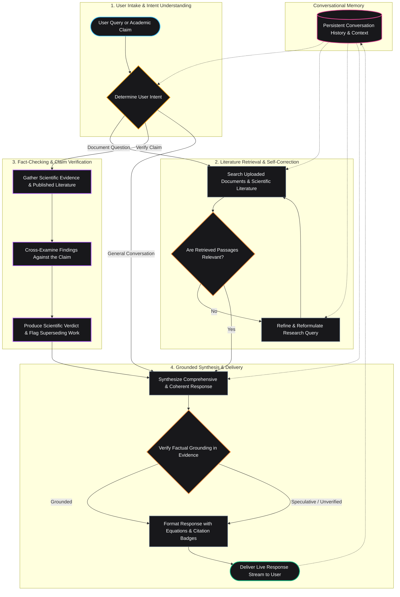

# Conversational Research RAG

An enterprise-grade, conversational research assistant designed for deep academic document analysis, evidence verification, and multi-turn scientific discovery. Powered by an autonomous Self-Reflective Retrieval-Augmented Generation (Self-RAG) state graph, full asynchronous FastAPI backend with Server-Sent Events (SSE) streaming, Upstash Redis persistent conversation checkpointer, and a modern Obsidian Black Streamlit interface with native LaTeX mathematical equation rendering.

---

> 🌐 **Live Demo & Deployment:**
> - **Streamlit Web Application:** [https://aryan-projects.duckdns.org/research-rag](https://aryan-projects.duckdns.org/research-rag)
> - **FastAPI Backend Swagger UI:** [http://aryan-projects.duckdns.org/research-rag-backend/docs](http://aryan-projects.duckdns.org/research-rag-backend/docs) (API Root: [http://aryan-projects.duckdns.org/research-rag-backend](http://aryan-projects.duckdns.org/research-rag-backend))
> - ⏰ **Availability:** The live link is active **Monday to Friday, 9:00 AM – 5:00 PM**.

---

## Key Highlights & Core Capabilities

* **Decoupled Architecture with Full Asynchronous Backend:**
  - Headless FastAPI service managing document ingestion, agent orchestration, and real-time SSE token streaming.
  - Fully asynchronous and non-blocking execution across all endpoints, database queries, and LangGraph nodes for maximum concurrency.
* **Modular Domain Routers & Lifespan Management:**
  - Clean separation of API endpoints into dedicated subfolders (`routes/health`, `routes/documents`, `routes/chat`, `routes/sessions`).
  - Lifespan context manager (`@asynccontextmanager`) managing resource startup, singleton initialization, and graceful shutdown.
  - Automated rotating file logger (`.logs/app.log`) with size-based rotation and file-watcher filter rules.
* **Context-Aware LLM Query Rewriting & Disambiguation:**
  - 100% LLM-driven query reformulation that eliminates fragile regex keyword lists.
  - Automatically disambiguates pronouns (`it`, `they`, `this method`) and implicit follow-up inquiries (*"What were the parameter efficiency results?"*) into self-contained, keyword-rich academic queries using prior conversation history.
  - Functions at both pre-retrieval dispatch (ensuring the very first search pass hits the vector store with concrete paper/concept names) and in corrective recovery loops.
* **Autonomous Self-RAG State Graph:**
  - Intelligent intent classification: separates conversational greetings and conceptual explanations from deep document inquiries and empirical fact-checking.
  - Corrective retrieval loop: dynamically filters irrelevant passages, reformulates unhelpful queries, and searches across both uploaded research papers and broader academic literature.
  - Hallucination guard: verifies generated statements against source evidence before delivering final responses.
* **Scientific Claim Verification & Fact-Checking:**
  - Autonomous fact-checking pipeline designed for academic literature.
  - Evaluates research claims against peer-reviewed papers and live web evidence, assigning clear verdicts (`SUPPORTED`, `REFUTED`, `PARTIALLY_SUPPORTED`, `INCONCLUSIVE`) with confidence scores and superseding citations.
* **Persistent Conversational Memory with Dual-Profile Modes:**
  - State checkpointing backed by Upstash Redis REST storage for persistent cross-session memory (up to 20 conversation turns with 131k context window).
  - **Dual Identity Modes:** Users can either specify a custom username to isolate, save, and reload their personal conversation history, or chat anonymously under a default profile.
  - Left sidebar session drawer allows creating new research sessions, switching between chats, downloading transcripts, and clearing memory.
* **Obsidian Black Major Theme & Polished UX:**
  - Premium dark obsidian aesthetic with glassmorphism cards, subtle glows, and clean typography.
  - Interactive citation drawer featuring page-level provenance, excerpt highlights, and visual page preview thumbnails from original PDFs.
* **LaTeX & Markdown Mathematical Rendering:**
  - Built-in mathematical normalization engine that standardizes display formulas (`\[ ... \]`), inline math (`\( ... \)`), and standalone environments (`equation`, `align`, `matrix`, `pmatrix`, `cases`) into KaTeX.
  - Custom responsive containers with smooth horizontal scrolling for long equations, dark styled tables, and highlighted syntax code blocks.
* **Ollama Cloud Multi-Key Resilience:**
  - High-performance reasoning powered by `gpt-oss:120b` via Ollama Cloud.
  - Automated zero-downtime key rotation that seamlessly falls back across secondary and tertiary API keys on rate limits or service interruptions.
* **Nomic Embed Text v1.5 & Dynamic Progress Estimation:**
  - High-dimensional dense vectors (768 dimensions) via OpenAI-compatible endpoint.
  - Asymmetric task prefixes (`search_query: ` for queries, `search_document: ` for documents) to optimize semantic search.
  - Server-Sent Events (SSE) streaming progress bar with real-time remaining-time calculations based on tested API latency (~1.07s/request baseline at ~0.93 req/s throughput).
* **Multi-Tier PDF Ingestion Engine:**
  - Layout-aware extraction using `pdfplumber` to preserve tabular grids as Markdown tables, with fallbacks to `PyMuPDF` (`fitz`) and `pypdf`.
  - Token-safe recursive chunking (500 chars, 100 overlap) and batching (10 chunks/request) to prevent physical model context overflow.
  - Fuses dense vector embeddings (Nomic Embed Text v1.5) and sparse lexical search (BM25) via Reciprocal Rank Fusion.
* **Optimized Multi-Stage Lightweight Docker Container:**
  - Two-stage architecture (`builder` -> `runner`) that strips build-essential toolchains, C-compilers, test packages, and pyc caches from the final image.
  - Minimal production attack surface with an integrated `HEALTHCHECK` for automated AWS EC2 self-healing.

---

## Agent Architecture & Workflow

The diagram below illustrates the end-to-end conceptual flow of how the conversational research assistant interprets user queries, searches academic literature, verifies claims, checks for factual grounding, and maintains conversational context.



### Workflow Walkthrough

1. **Intake & Intent Understanding:**
   - The user query is analyzed to understand the context of the inquiry. It directs the workflow to the appropriate track: deep literature search, empirical claim fact-checking, or direct conversational synthesis.
2. **Context-Aware Retrieval & Self-Correction:**
   - Evaluates whether indexed passages from uploaded research papers or external scientific literature answer the question.
   - When conversational history exists, the LLM autonomously resolves ambiguous follow-up questions and pronouns (e.g., *"What were its parameter efficiency results?"*) into concrete, self-contained search terms before querying ChromaDB and BM25.
   - If initial passages are incomplete or off-target, the query is autonomously reformulated using academic nomenclature and searched again.
3. **Scientific Claim Verification:**
   - Scientific propositions undergo targeted literature reviews, cross-examining published evidence to produce a verified verdict (`SUPPORTED`, `REFUTED`, `PARTIALLY_SUPPORTED`, or `INCONCLUSIVE`) accompanied by citations of any superseding studies.
4. **Grounded Answer Synthesis & KaTeX Formatting:**
   - The response is composed from verified evidence and previous conversational turns.
   - An integrated factual grounding check screens the draft against hallucinations before formatting the text with clickable citations, evidence quotes, and LaTeX mathematical equations.
5. **Persistent Conversation Memory:**
   - Dialogue turns are saved to persistent cloud storage via Upstash Redis REST checkpointer, maintaining multi-turn context (up to 20 turns) across chat sessions and client reloads.

---

## Technology Stack

| Layer | Technologies |
| :--- | :--- |
| **Workflow & Agent Orchestration** | LangGraph, LangChain Core |
| **Backend & Streaming API** | FastAPI, Uvicorn, Server-Sent Events (SSE) |
| **Frontend & User Interface** | Streamlit, Vanilla CSS (Obsidian Black Theme) |
| **Mathematical Rendering** | KaTeX Mathematical Engine, Markdown Normalizer |
| **Reasoning Model (LLM)** | Ollama Cloud (`gpt-oss:120b`) with multi-key failover |
| **Hybrid Document Retrieval** | ChromaDB (Dense Vectors), BM25 (Sparse Lexical), Ensemble Reciprocal Rank Fusion |
| **Embeddings Model** | Nomic Embed Text v1.5 (`nomic-embed-text-v1.5`, 768 dimensions, OpenAI-compatible API) |
| **Document Parsing** | `pdfplumber` (layout & tables), `PyMuPDF` (`fitz`), `pypdf` |
| **External Literature Tools** | Tavily Web Search API, ArXiv Public Literature API |
| **State Persistence & Memory** | Upstash Redis Cloud REST API, LangGraph Checkpointer |
| **Observability & Tracing** | LangSmith |
| **Containerization & Deployment** | Docker (Multi-Stage Lightweight Build), Amazon ECR, AWS CodeDeploy |

---

## Project Structure

```text
conversational-research-rag/
│
├── backend/                              # Full Asynchronous Backend
│   ├── api.py                            # FastAPI app assembly with lifespan & rotating logs
│   ├── main.py                           # Application entrypoint alias
│   ├── config.py                         # Environment, LLMs, embeddings & API settings
│   │
│   ├── routes/                           # Modular API Routers by Domain
│   │   ├── __init__.py                   # Aggregates & exposes all sub-routers
│   │   ├── health/                       # Health & root endpoints (GET /, GET /health)
│   │   │   └── router.py
│   │   ├── documents/                    # PDF upload & SSE streaming ingestion (POST /upload, POST /upload/stream)
│   │   │   └── router.py
│   │   ├── chat/                         # Query execution & SSE streaming (POST /chat, POST /chat/stream)
│   │   │   └── router.py
│   │   └── sessions/                     # Upstash Redis user sessions & memory lifecycle
│   │       └── router.py
│   │
│   ├── services/                         # Business & Orchestration Layer
│   │   ├── __init__.py                   # Re-exports AgentService & QueryResult
│   │   └── agent_service.py              # LangGraph workflow compilation & streaming engine
│   │
│   ├── database/                         # State Persistence & Memory Layer
│   │   ├── __init__.py                   # Checkpointer factory & session state functions
│   │   └── redis.py                      # Upstash Redis async/sync checkpointer & session storage
│   │
│   ├── schemas/                          # Pydantic Schemas & State Models
│   │   ├── __init__.py
│   │   ├── state.py                      # GraphState definition
│   │   ├── router.py                     # RouterDecision schema
│   │   ├── relevancy.py                  # DocumentRelevanceGrade schema
│   │   ├── rewrite.py                    # QueryRewrite schema
│   │   └── claim.py                      # ClaimAnalysisResult & SupersedingPaper schemas
│   │
│   ├── prompts/                          # Centralized LangChain Prompts
│   │   ├── __init__.py
│   │   ├── router.py                     # Intent routing prompt
│   │   ├── agent.py                      # Tool selection prompt
│   │   ├── relevancy.py                  # Document grading prompt
│   │   ├── rewrite.py                    # Academic query expansion prompt
│   │   ├── claim.py                      # Literature claim analysis prompt
│   │   └── generation.py                 # Grounded synthesis prompt
│   │
│   ├── graph/                            # LangGraph StateGraph Architecture
│   │   ├── __init__.py
│   │   ├── edges.py                      # Conditional routing edges
│   │   ├── workflow.py                   # Graph compilation (build_graph)
│   │   └── nodes/                        # Async Node Handlers
│   │       ├── __init__.py
│   │       ├── router_node.py            # Intent classification node
│   │       ├── agent_node.py             # Context-aware tool coordination & execution node
│   │       ├── relevancy_node.py         # Concurrent document relevance check
│   │       ├── rewrite_node.py           # Contextual query reformulation & fallback node
│   │       ├── claim_node.py             # ArXiv search, claim analysis & verdict
│   │       └── generation_node.py        # Conversational answer generation & Self-RAG grounding
│   │
│   ├── tools/                            # External Research Tools
│   │   ├── __init__.py
│   │   └── tools.py                      # Tavily web search, ArXiv query & vectorstore tools
│   │
│   ├── ingestion/                        # Document Ingestion Pipeline
│   │   ├── __init__.py
│   │   ├── embeddings.py                 # Nomic embeddings factory (LangChain OpenAIEmbeddings)
│   │   ├── loader.py                     # Layout-aware PDF & table parser
│   │   ├── splitter.py                   # Recursive character text chunker
│   │   ├── retriever.py                  # Hybrid EnsembleRetriever (Chroma + BM25) with dynamic progress
│   │   └── pipeline.py                   # Async ingestion pipeline
│   │
│   └── utils/                            # Shared Utilities
│       ├── __init__.py
│       └── helpers.py                    # Document formatters, citation extractors, async runner
│
├── frontend/                             # Streamlit Client Interface
│   ├── __init__.py
│   ├── app.py                            # Streamlit chat application
│   ├── api_client.py                     # Async-ready HTTP & SSE communication layer
│   ├── styles.py                         # Obsidian Black major theme styling & KaTeX CSS
│   │
│   └── components/                       # Modular UI Components by Domain
│       ├── __init__.py                   # Re-exports all components for seamless access
│       ├── common/                       # Header, welcome state & document cards
│       │   ├── __init__.py
│       │   ├── header.py
│       │   ├── welcome.py
│       │   └── documents.py
│       ├── sidebar/                      # User profile identity & session sidebar
│       │   ├── __init__.py
│       │   ├── identity.py
│       │   └── sessions.py
│       ├── citations/                    # Verdict badges, grounding status & visual PDF preview
│       │   ├── __init__.py
│       │   ├── badges.py
│       │   └── sources.py
│       └── chat/                         # LaTeX normalizer, message turns & history renderer
│           ├── __init__.py
│           ├── formatter.py
│           └── messages.py
│
├── deploy/                               # Deployment & Infrastructure
│   └── scripts/
│       ├── install_dependencies.sh       # Server dependency bootstrapper
│       ├── start_docker.sh               # ECR login & container runner
│       └── stop_docker.sh                # Clean container shutdown
│
├── .github/workflows/                    # CI/CD Workflows
│   └── deploy.yml                        # Automated testing, building & AWS EC2 deployment
│
├── app.py                                # Root runner: streamlit run app.py
├── api.py                                # Root runner: fastapi dev api.py / uvicorn api:app
├── entrypoint.sh                         # Multi-process container launcher
├── appspec.yml                           # AWS CodeDeploy deployment specification
├── requirements.txt                      # Project dependencies
├── .env / .env.rag                       # Environment variables
├── .dockerignore                         # Container build exclusion rules
├── Dockerfile                            # Docker multi-stage container build
├── LICENSE                               # MIT License
└── README.md                             # Documentation & Architecture
```

---

## API Reference & Endpoints

The FastAPI backend exposes fully asynchronous, modular REST endpoints organized by domain:

| Domain | Method | Endpoint | Description |
| :--- | :--- | :--- | :--- |
| **System** | `GET` | `/` | Root greeting and API running confirmation. |
| **Health** | `GET` | `/health` | Service health status and active retriever indexing check. |
| **Documents** | `POST` | `/upload` | Multipart PDF upload. Parses layout, chunks text, creates embeddings, and updates the hybrid retriever. |
| **Documents** | `POST` | `/upload/stream` | Server-Sent Events (SSE) streaming PDF ingestion with dynamic request counters and remaining-time estimation. |
| **Chat** | `POST` | `/chat` | Executes LangGraph research query synchronously, returning formatted answer, verdict, and citations. |
| **Streaming** | `POST` | `/chat/stream` | Server-Sent Events (SSE) streaming progress status, real-time tokens, and final answer payload. |
| **Sessions** | `GET` | `/user/{username}/sessions` | Fetches stored conversation sessions for a user from Upstash Redis (or in-memory cache). |
| **Sessions** | `POST` | `/user/{username}/sessions` | Persists conversation sessions dictionary for a user to Upstash Redis. |
| **Sessions** | `DELETE`| `/user/{username}/session/{session_id}` | Deletes a single conversation session and its LangGraph checkpointer memory. |
| **Memory** | `POST` | `/session/{session_id}/clear` | Clears conversation state checkpointer memory for a specific session ID. |
| **Memory** | `POST` | `/user/{username}/clear` | Clears all conversation sessions and checkpointer memory threads for a user. |

### Streaming Event Format (`POST /upload/stream`)
Real-time Server-Sent Events during document layout extraction, chunking, and batch embedding generation:
* **Parsing:** `data: {"type": "progress", "stage": "parsing", "message": "Extracting text...", "percent": 5.0}`
* **Started:** `data: {"type": "progress", "stage": "started", "completed_requests": 0, "total_requests": 9, "estimated_remaining_seconds": 9.6, "rate_seconds_per_req": 1.07}`
* **Embedding Progress:** `data: {"type": "progress", "stage": "embedding", "completed_requests": 4, "total_requests": 9, "estimated_remaining_seconds": 5.4, "rate_seconds_per_req": 1.08, "percent": 44.4}`
* **Completion:** `data: {"type": "completed", "status": "success", "chunks_indexed": 89, "files": ["paper.pdf"], "percent": 100.0}`

### Streaming Event Format (`POST /chat/stream`)
The streaming chat endpoint delivers live Server-Sent Events with standard JSON payloads:
* **Node Status:** `data: {"type": "status", "node": "retrieve"}`
* **Token Chunks:** `data: {"type": "token", "content": "..."}`
* **Final Synthesis:** `data: {"type": "final", "answer": "...", "route": "retrieve", "sources": [...], "claim_analysis": {...}, "reflection_logs": [...]}`
* **Termination:** `data: [DONE]`

---

## Port Mappings & Network Architecture

| Service | Local Dev Port | Container Port | AWS EC2 Host Port | Reverse Proxy Path / Live URL |
| :--- | :--- | :--- | :--- | :--- |
| **FastAPI Backend & Swagger Docs** | `8000` | `8000` | `8001` (`8001:8000`) | [http://aryan-projects.duckdns.org/research-rag-backend/docs](http://aryan-projects.duckdns.org/research-rag-backend/docs) (Root: `/research-rag-backend`) |
| **Streamlit Web Application** | `8501` | `7860` | `8502` (`8502:7860`) | [https://aryan-projects.duckdns.org/research-rag](https://aryan-projects.duckdns.org/research-rag) (Base URL: `/research-rag`) |

> [!NOTE]
> The live deployment link is active **Monday to Friday, 9:00 AM – 5:00 PM**. All port numbers and subpath routes (`--root-path /research-rag-backend` and `--server.baseUrlPath=research-rag`) are strictly aligned across local development, Docker containerization, and reverse proxy routing on AWS EC2.

---

## Getting Started

### Prerequisites

* Python 3.11+
* [Ollama Cloud Account & API Key](https://ollama.com/settings/keys)
* Remote Nomic Embedding API Key (`EMBEDDING_MODEL_KEY` for `https://nomicapi.duckdns.org/v1`)
* [Upstash Redis REST Database](https://upstash.com) (for persistent conversation history)
* [Tavily API Key](https://app.tavily.com) (optional, for live web search; falls back to ArXiv)

### 1. Clone the Repository

```bash
git clone git@github-personal:Aryanupadhyay23/conversational-research-rag.git
cd conversational-research-rag
```

### 2. Configure Environment Variables

Create a `.env` file (or `.env.rag` on shared production servers) in the project root:

```env
# Ollama Cloud Configuration (single key or multi-key automatic failover)
OLLAMA_API_KEY_ONE="your_primary_ollama_key"
OLLAMA_API_KEY_TWO="your_secondary_backup_key"
OLLAMA_API_KEY_THREE="your_tertiary_backup_key"

OLLAMA_MODEL="gpt-oss:120b"
OLLAMA_NUM_CTX=131072
OLLAMA_BASE_URL="https://ollama.com"
MAX_CHAT_HISTORY_MESSAGES=20
RETRIEVER_K=6

# Embeddings & Search Configuration (Nomic Embed Text v1.5)
EMBEDDING_MODEL_KEY="your_nomic_api_key"
EMBEDDING_BASE_URL="https://nomicapi.duckdns.org/v1"
EMBEDDING_MODEL_NAME="nomic-embed-text-v1.5"
EMBEDDING_DIMENSION=768
EMBEDDING_CHUNK_SIZE=10
BASELINE_EMBEDDING_LATENCY=1.07
BASELINE_EMBEDDING_THROUGHPUT=0.93
CHUNK_SIZE=500
CHUNK_OVERLAP=100
TAVILY_API_KEY="your_tavily_api_key"

# Upstash Redis Configuration (LangGraph Checkpointer & User Session Storage)
UPSTASH_REDIS_REST_URL="https://your-database.upstash.io"
UPSTASH_REDIS_REST_TOKEN="your_upstash_token"

# Optional: LangSmith Observability
LANGCHAIN_TRACING_V2=true
LANGCHAIN_API_KEY="your_langsmith_api_key"
LANGCHAIN_PROJECT="PDF_RAG_CHATBOT"
```

---

### Option A: Local Development

1. **Install dependencies:**

   ```bash
   pip install -r requirements.txt
   ```

2. **Launch the FastAPI Backend (Terminal 1):**

   ```bash
   uvicorn api:app --reload --port 8000
   ```

   * Backend API: `http://localhost:8000`
   * Interactive Swagger Docs: `http://localhost:8000/docs`

3. **Launch the Streamlit Frontend (Terminal 2):**

   ```bash
   streamlit run app.py
   ```

   * Chat Interface: `http://localhost:8501` (communicates with `http://localhost:8000` by default).

---

### Option B: Docker Deployment (Single Command)

The container leverages an **optimized multi-stage build** (`builder` -> `runner`) that isolates compilation tools and strips pyc bytecode caches, resulting in a minimal runtime image. Both FastAPI and Streamlit run concurrently via [`entrypoint.sh`](entrypoint.sh) with integrated container health checking:

1. **Build the Docker Image:**

   ```bash
   docker build -t conversational-research-rag .
   ```

2. **Run the Container:**

   ```bash
   docker run -p 7860:7860 -p 8000:8000 --env-file .env conversational-research-rag
   ```

   * **Web Interface:** Access at `http://localhost:7860`
   * **API Documentation:** Access at `http://localhost:8000/docs`
   * **Container Health Status:** Monitored automatically via `HEALTHCHECK` (`http://localhost:8000/health`)

---

### Option C: Production Deployment on AWS EC2 (Automated CI/CD)

The application is deployed to **Amazon EC2** using GitHub Actions, Amazon ECR, and AWS CodeDeploy:

1. **Automated Pipeline ([.github/workflows/deploy.yml](.github/workflows/deploy.yml)):**
   - Automatically runs syntax verification and compilation smoke tests on push to `main` / `master`.
   - Builds the production Docker image and pushes it to **Amazon ECR**.
   - Packages [`appspec.yml`](appspec.yml) and deployment scripts (`deploy/scripts/`) into an S3 bundle.
   - Triggers **AWS CodeDeploy** to perform a zero-downtime rolling update on your EC2 instance.

2. **EC2 Host & Live Domain Mappings (Active Mon–Fri, 9:00 AM – 5:00 PM):**
   - **Streamlit Web Application:** [https://aryan-projects.duckdns.org/research-rag](https://aryan-projects.duckdns.org/research-rag) (or `http://<EC2-HOST-IP>:8502/research-rag` mapped to container port `7860` via `--server.baseUrlPath=research-rag`).
   - **FastAPI Backend & Swagger Docs:** [http://aryan-projects.duckdns.org/research-rag-backend/docs](http://aryan-projects.duckdns.org/research-rag-backend/docs) (or `http://<EC2-HOST-IP>:8001/research-rag-backend/docs` mapped to container port `8000` via `--root-path /research-rag-backend`).
   - Managed automatically via [`deploy/scripts/start_docker.sh`](deploy/scripts/start_docker.sh) with automatic restart policies.

---

## Example Research Use Cases

* **Academic Paper Analysis:** Upload multiple related papers, ask comparative synthesis questions, and receive citation-backed answers with page-level previews.
* **Empirical Claim Verification:** Fact-check scientific claims, benchmark findings, or methodologies against published literature with automated verdict grading.
* **Mathematical & Algorithmic Discovery:** Explore complex equations, loss functions, or proofs rendered with high-contrast LaTeX formatting.
* **Long-Term Literature Tracking:** Organize multi-turn research conversations under dedicated user profiles backed by persistent cloud storage.

---

## License

This project is open-source and distributed under the [MIT License](LICENSE).