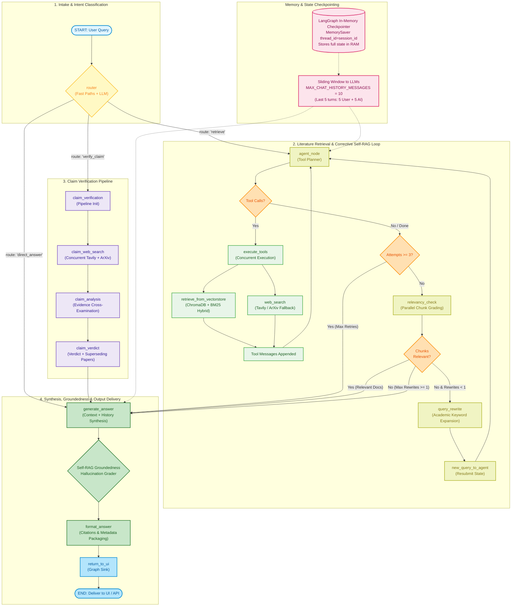

# Research Paper RAG Project

**Live Demo:** [Hugging Face Spaces: Conversational_PDF_RAG](https://huggingface.co/spaces/Aryan2301/Conversational_PDF_RAG)

An end-to-end **Self-Reflective Retrieval-Augmented Generation (Self-RAG)** conversational chatbot built with **LangGraph**, **Streamlit**, **Ollama Cloud (`gpt-oss:120b`)**, **ChromaDB**, and **Google Gemini Embeddings**. Upload multiple PDF documents and converse with their content through an autonomous, self-correcting agent state graph.

The agent actively reflects on retrieved context relevance, transforms unhelpful queries, verifies generated answers against hallucinations, and evaluates answer quality before responding.

---

## Key Features

* **Decoupled Client-Server Architecture:** Clean separation of concerns — a headless FastAPI backend manages ingestion, agent execution, and Server-Sent Events (SSE) streaming, while a dedicated Streamlit frontend acts purely as the user interface.
* **Conversational Intent Router:** Distinguishes general greetings and chit-chat from document questions, replying warmly and instantly without redundant document searches.
* **Self-RAG Architecture with LangGraph:** Autonomous state graph workflow featuring self-reflection, hallucination detection, and query transformation loops.
* **Hybrid Retrieval (BM25 + Semantic Chroma):** Combines lexical keyword matching (BM25) and dense vector search (Chroma) fused via LangChain's native `EnsembleRetriever` using Reciprocal Rank Fusion (RRF).
* **Safe Ingestion Batching:** Document splits are indexed in resilient batches (`EMBEDDING_BATCH_SIZE = 50`) to reliably process large PDFs without exceeding API batch limits.
* **Fully Asynchronous Execution:** Entire graph is implemented with non-blocking async nodes (`ainvoke`) and concurrent evaluations (`asyncio.gather`) for parallel document grading and simultaneous hallucination/relevance verification.
* **Conversational Checkpointer Memory:** Seamlessly preserves conversation history and context across multi-turn interactions (last 5 dialogue turns / 10 messages) using LangGraph's native in-memory checkpointer (`MemorySaver`).
* **Document Relevance Reflection:** Filters out low-quality/irrelevant retrieved chunks concurrently before generation.
* **Dynamic Query Transformation:** Automatically rewrites the query using memory context and retries retrieval if initial documents are insufficient or irrelevant.
* **Hallucination & Faithfulness Guard:** Evaluates if generated responses are factually grounded in the provided document context.
* **Answer Quality Assessment:** Checks that the final answer directly and comprehensively addresses the user's inquiry.
* **Clean Conversational UI:** Distraction-free, centered chat experience with clean message streams.
* **Smart Ingestion Caching:** Vectorstore indexing is cached so PDFs are only processed once per upload batch, eliminating rerun latency.
* **Ollama Cloud Integration & Multi-Key Fallback:** High-performance reasoning powered by `gpt-oss:120b` via Ollama Cloud with automatic zero-downtime key failover (`with_fallbacks`) across multiple API keys on 429 rate limits or errors.
* **Document & Table Parsing via `pdfplumber` & `PyMuPDF`:** Layout-aware PDF text extraction and tabular grid parsing into Markdown tables, with automatic fallbacks to PyMuPDF and `pypdf`.
* **Observability with LangSmith:** Full execution tracing out-of-the-box to visualize the agent's graph operations, chunk retrievals, and evaluation steps.
* **Docker Ready:** Fully containerized for easy and consistent deployments.

---

## Tech Stack

* **Orchestration & Workflow:** [LangGraph](https://github.com/langchain-ai/langgraph), [LangChain Core](https://github.com/langchain-ai/langchain)
* **Backend & Streaming API:** FastAPI, Uvicorn (Server-Sent Events)
* **Frontend:** Streamlit
* **LLM Provider:** Ollama Cloud (`gpt-oss:120b` via `langchain-ollama`)
* **Hybrid Retrieval:** BM25 (`rank_bm25`), ChromaDB (`langchain-chroma`), LangChain `EnsembleRetriever`
* **Embeddings:** Google Gemini Embeddings (`gemini-embedding-2`, 768 dimensions via `langchain-google-genai`)
* **Document Processing:** `pdfplumber` (layout & tables), `PyMuPDF` (`fitz`), `pypdf`, RecursiveCharacterTextSplitter
* **Observability:** LangSmith

## Agent Architecture & Workflow



### End-to-End Workflow Breakdown

1. **Intake & Intent Classification (`router`):**
   - The user query is evaluated via deterministic fast paths (greetings, claim keywords, PDF-specific cues) with LLM classification fallback into one of three routes: `retrieve`, `verify_claim`, or `direct_answer`.
2. **Literature Retrieval & Corrective Self-RAG Loop (`agent_node` $\leftrightarrow$ `execute_tools`):**
   - **`agent_node`:** Coordinates tool dispatches for the current query and filters prior turns.
   - **`execute_tools`:** Concurrently queries **ChromaDB + BM25 Hybrid Ensemble** and **Tavily / ArXiv**, returning chunks and updating retrieval attempt counts.
   - **`relevancy_check`:** Uses an evaluator LLM to grade retrieved chunks concurrently, dropping irrelevant noise.
   - **`query_rewrite` & `new_query_to_agent`:** If all passages fail relevance, the query is reformulated with academic terminology and cycled back to `agent_node` (bounded by `MAX_QUERY_REWRITES = 1` and `MAX_RETRIEVAL_ATTEMPTS = 3`).
3. **Claim Verification Pipeline (`claim_verification` $\rightarrow$ `claim_verdict`):**
   - **`claim_web_search`:** Gathers empirical evidence from both live web sources and peer-reviewed ArXiv papers in parallel.
   - **`claim_analysis`:** Cross-examines literature to assign a verdict (`SUPPORTED`, `REFUTED`, `PARTIALLY_SUPPORTED`, `INCONCLUSIVE`) with confidence scoring.
   - **`claim_verdict`:** Packages verdict results and flags any superseding research.
4. **Direct Answer Branch (`direct_answer`):**
   - Skips tool execution for conversational pleasantries, greetings, and common conceptual explanations.
5. **Answer Synthesis, Self-RAG Groundedness & Output Delivery:**
   - **`generate_answer`:** Synthesizes an authoritative answer conditioned on verified context and conversation history.
   - **Self-RAG Groundedness Guard (`_check_groundedness`):** Evaluates whether the generated response is strictly grounded in evidence, flagging speculative assertions or hallucinations.
   - **`format_answer` & `return_to_ui`:** Binds clickable citations, provenance metadata, and verdict badges, delivering the final response to the UI/API.

---

### Memory & Conversation Turn Management

| Component | Implementation | Capacity / Window | Details |
| :--- | :--- | :--- | :--- |
| **Checkpointer** | LangGraph `MemorySaver` | Process RAM (In-Memory) | Checkpoints state per `session_id` (`thread_id`) without external database dependencies. |
| **LLM Context Window** | `filter_messages` | **10 messages (5 turns)** | Configured via `MAX_CHAT_HISTORY_MESSAGES = 10`. Passes the last 5 human-AI dialogue turns to `agent_node` and `generate_answer` to maintain conversational continuity while avoiding context dilution. |
| **UI History** | Streamlit `st.session_state` | Full session transcript | Preserves and displays the complete interaction history in the chat sidebar and message thread. |

---

## Getting Started

### Prerequisites

* Python 3.11+
* [Ollama Cloud Account & API Key](https://ollama.com/settings/keys)
* [Google AI Studio API Key](https://aistudio.google.com/app/apikey) (for Gemini Embeddings)
* [Tavily API Key](https://app.tavily.com) (optional, for live web research; falls back to ArXiv)
* [Hugging Face Token](https://huggingface.co/settings/tokens) (optional)

### 1. Clone the Repository

```bash
git clone <your_repo_url>
cd conversational-pdf-rag
```

### 2. Set Up Environment Variables

Create a `.env` file (or `.env.rag` on shared servers like EC2 to avoid collisions) in the root directory:

```env
# Ollama Cloud Configuration (supports single key or multi-key automatic failover)
OLLAMA_API_KEY_ONE="your_primary_ollama_key"
OLLAMA_API_KEY_TWO="your_secondary_backup_key"
OLLAMA_API_KEY_THREE="your_third_backup_key"
# Alternatively, single key:
# OLLAMA_API_KEY="your_single_key"

OLLAMA_MODEL="gpt-oss:120b"
OLLAMA_BASE_URL="https://ollama.com"
GOOGLE_API_KEY="your_google_gemini_api_key"
TAVILY_API_KEY="your_tavily_api_key"
HF_TOKEN="your_huggingface_token"

# Optional: LangSmith Tracing
LANGCHAIN_TRACING_V2=true
LANGCHAIN_API_KEY="your_langsmith_api_key"
LANGCHAIN_PROJECT="PDF_RAG_CHATBOT"
```

---

### Option A: Local Installation

1. **Install dependencies:**

   ```bash
   pip install -r requirements.txt
   ```

2. **Start the FastAPI Backend (Terminal 1):**

   The backend orchestrates PDF parsing, vector indexing, LangGraph state machine execution, and SSE token streaming:

   ```bash
   uvicorn api:app --reload --port 8000
   ```

   The backend API will start at `http://localhost:8000` (interactive OpenAPI docs at `http://localhost:8000/docs`).

3. **Start the Streamlit Frontend (Terminal 2):**

   The frontend is a dedicated client UI that sends PDF uploads to the FastAPI backend and live-streams assistant responses from the `/chat/stream` endpoint:

   ```bash
   streamlit run app.py
   ```

   The web interface will open at `http://localhost:8501`. It connects to `BACKEND_URL=http://localhost:8000` by default.

---

### Option B: Docker Deployment

When deploying via Docker, you **only run a single command**. The container automatically launches both services via [`entrypoint.sh`](entrypoint.sh):
* **FastAPI Backend** starts in the background on port `8000`.
* **Streamlit Frontend** starts in the foreground on port `7860` and communicates with the backend over internal `http://localhost:8000`.

1. **Build the Docker image:**

   ```bash
   docker build -t conversational-pdf-rag .
   ```

2. **Run the Docker container (Single Command):**

   ```bash
   docker run -p 7860:7860 -p 8000:8000 --env-file .env conversational-pdf-rag
   ```

   * **Streamlit Chat UI**: Access at `http://localhost:7860`
   * **FastAPI REST & Streaming API**: Access at `http://localhost:8000` (Interactive Swagger docs at `http://localhost:8000/docs`)

   *(Note: On platforms like Hugging Face Spaces that expose a single port `7860`, Streamlit serves the web interface on `7860` while communicating with FastAPI internally over port `8000`).*

---

## Project Structure

```text
conversational-pdf-rag/
│
├── backend/                              # Complete Backend Core
│   ├── config.py                         # LLM, embeddings & API configuration
│   ├── service.py                        # Orchestrator service (AgentService)
│   ├── api.py                            # FastAPI streaming backend endpoint
│   │
│   ├── schemas/                          # Pydantic Schemas & State (in one folder)
│   │   ├── __init__.py                   # Re-exports all schemas
│   │   ├── state.py                      # GraphState schema
│   │   ├── router.py                     # RouterDecision schema
│   │   ├── relevancy.py                  # DocumentRelevanceGrade schema
│   │   ├── rewrite.py                    # QueryRewrite schema
│   │   └── claim.py                      # ClaimAnalysisResult & SupersedingPaper
│   │
│   ├── prompts/                          # LangChain Prompts (in one folder)
│   │   ├── __init__.py                   # Re-exports all prompts
│   │   ├── router.py                     # router_prompt
│   │   ├── agent.py                      # agent_system_prompt
│   │   ├── relevancy.py                  # relevancy_prompt
│   │   ├── rewrite.py                    # query_rewrite_prompt
│   │   ├── claim.py                      # claim_analysis_prompt
│   │   └── generation.py                 # answer_generation_prompt
│   │
│   ├── graph/                            # LangGraph StateGraph Architecture
│   │   ├── __init__.py                   # Graph exports
│   │   ├── edges.py                      # Conditional routing edges
│   │   ├── workflow.py                   # Single compilation file (build_graph)
│   │   └── nodes/                        # Separated LangGraph Nodes
│   │       ├── __init__.py               # Re-exports all nodes
│   │       ├── router_node.py            # Router decision node
│   │       ├── agent_node.py             # Agent Node & Tool execution
│   │       ├── relevancy_node.py         # Document relevance grading
│   │       ├── rewrite_node.py           # Query rewrite & state resubmission
│   │       ├── claim_node.py             # Claim search, analysis & verdict
│   │       └── generation_node.py        # Answer generation & metadata formatting
│   │
│   ├── tools/                            # External Tools
│   │   ├── __init__.py                   # Tool exports
│   │   └── tools.py                      # Tavily search, ArXiv query & vectorstore
│   │
│   ├── ingestion/                        # Document & Vector Processing
│   │   ├── __init__.py
│   │   ├── loader.py                     # Multi-tier PDF parsing (pdfplumber tables, PyMuPDF, pypdf)
│   │   ├── splitter.py                   # RecursiveCharacterTextSplitter
│   │   ├── retriever.py                  # Hybrid EnsembleRetriever (BM25 + Chroma)
│   │   └── pipeline.py                   # End-to-end ingestion pipeline
│   │
│   └── utils/                            # Shared Utilities
│       ├── __init__.py
│       └── helpers.py                    # Async safe runner, document formatters
│
├── frontend/                             # Streamlit Frontend (Decoupled)
│   ├── __init__.py
│   ├── app.py                            # Streamlit chat interface
│   ├── api_client.py                     # HTTP & SSE client communicating with FastAPI
│   ├── components.py                     # Message renderer, badges & citation expanders
│   └── styles.py                         # Custom dark blue black CSS styling
│
├── app.py                                # Root runner: streamlit run app.py
├── api.py                                # Root runner: uvicorn api:app
├── entrypoint.sh                         # Multi-process container launcher
├── requirements.txt                      # Project dependencies
├── .env                                  # Environment variables
├── Dockerfile                            # Docker configuration
└── README.md                             # Documentation & Mermaid workflow
```

---

## Example Use Cases

* **Research Paper Q&A:** Deep dive into complex papers with hallucination-checked citations.
* **Technical Manuals & Documentation:** Pinpoint exact steps and verify factual accuracy.
* **Legal & Contract Analysis:** Ensure responses reflect only the uploaded text.
* **Educational Assistant:** Chat with textbooks and lecture notes with conversational memory.

---

## License

This project is open-source and available under the [MIT License](LICENSE).